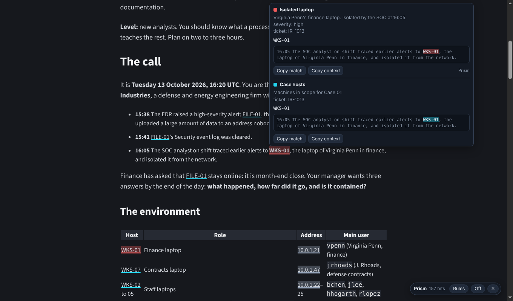

# Prism CDP

Prism highlighting on every page you visit in Microsoft Edge or Google Chrome, driven from a small Python controller over the Chrome DevTools Protocol. No extension needed.

Same engine as [Prism](https://jon.glass/prism/): regex rules color matches as pages load and change, and hovering a hit shows its rule, its notes and capture groups. Your signatures come from a CSV file, and any extra columns (severity, MITRE ID, ticket…) show on the hover card.

**Good for:** Seeing your indicators and patterns in the consoles you already work in, like ticket queues, EDR and SIEM pages and web chat, without copying text out.

**Post:** [Painting Every Page With Your Own Patterns](https://jon.glass/blogsabout/painting-every-page-with-your-own-patterns/)



## Run it

```sh
git clone https://github.com/glassdfir/prism-cdp
cd prism-cdp
python3 prism_cdp.py --rules my-signatures.csv
```

Edge opens with its own Prism profile, and every tab you open in that window gets highlighted. Your normal browser windows stay open alongside it. The first time, sign in to whatever sites you need in the Prism window. Sign-ins persist between runs.

**Chrome:** add `--chrome` (or `--browser chrome`). If you don't name a browser and Edge isn't installed, Prism uses Chrome. Each browser gets its own profile folder, `~/.prism-cdp/edge-profile` or `~/.prism-cdp/chrome-profile`. `--browser` also takes the path to any other Chromium browser, and `PRISM_BROWSER` sets a default.

Edit the rules file and every open tab picks up the change within a second. With no `--rules`, Prism uses `./rules.csv` or `./rules.prism.json` from the folder you run it in, if either exists. `--starter` uses `starter.csv`. No rules are built into the code.

## Rules files

**CSV** (or `.tsv`) is the easiest to maintain. You need a header row, then one signature per row:

```csv
# Lines starting with # are comments
name,pattern,flags,color,style,on,desc,severity,mitre
Cred dumping,\b(?:mimikatz|sekurlsa)\b,i,#ef5b5b,fill,yes,Credential theft tooling,high,T1003
IPv4,"\b(?:\d{1,3}\.){3}\d{1,3}\b",,#4c8dff,,,,low,
```

- Only `pattern` is required. Write patterns as you would in a regex tester, with no JSON escaping. They're JavaScript regular expressions.
- Quote any cell that contains a comma. `{1,3}` is the usual culprit. If you forget, Prism puts the pieces back into the pattern and warns you which line it fixed.
- `flags`: any of `i m s u`. `color`: `#rrggbb` (one is picked if blank). `style`: `fill`, `underline`, `box` or `text`. `on`: blank or `yes` runs the rule, while `no`, `off`, `false` or `0` keeps it but skips it.
- Header names aren't case-sensitive, and common alternatives work: `signature`/`title` for name, `regex` for pattern, `description`, `enabled`, `colour`.
- **Any other column** (severity, MITRE ID, ticket, owner…) is shown on the hover card under the description.
- Saved from Excel? That works too, including Excel's byte-order mark.

### Build them in Prism

The [Prism](https://jon.glass/prism/) web app is a good place to write rules: paste a sample of the page or log you care about, and you see every match and every capture group as you type the pattern. Prism CDP reads what Prism saves, as it is:

- **A saved file:** Prism → **Sets → Save rules to a file…** downloads a `.prism.json`. Pass it to `--rules`.
- **A link:** Prism → **Sets → Copy a link to these rules**, then paste it in quotes: `--rules "https://jon.glass/prism/#rules=z…"`. A text file holding the link works too.
- **Your downloads folder:** every save downloads a new file, and browsers name repeats `case01 (1).prism.json`, `case01 (2).prism.json`… So point `--rules` at the folder or a pattern, and Prism CDP always uses the newest match. It switches as soon as you save again, and waits if there's nothing there yet:

```sh
python3 prism_cdp.py --rules ~/Downloads/case01*.prism.json
```

A folder (`--rules ~/Downloads`) takes the newest `.prism.json`, `.csv`, `.tsv` or `.json` in it. Each rule's name, pattern, flags, color, style, notes and on/off come across; the indicator flag only matters for Prism's hand-off to Tessera, so it's ignored here.

Runs on macOS, Windows and Linux with Python 3.9 or newer, using the standard library only, so there's nothing to install. The `python3` that comes with macOS is fine. On Windows, use `py prism_cdp.py` (or `python`) from PowerShell or Command Prompt. Prism finds Edge and Chrome (stable, Beta, Dev and Canary) in their usual install folders.

## Three ways to connect

| | Command | Debugging port |
|---|---|---|
| **Pipe** (default on macOS and Linux) | `python3 prism_cdp.py` | None. The controller and the browser talk over a private pipe. |
| **Port** (always on Windows) | `python3 prism_cdp.py --port` | `127.0.0.1:61455` (G-L-A-S-S), so other CDP tools can use the same browser |
| **Attach** | `python3 prism_cdp.py --attach` | Whatever the running browser already has open (61455 unless you name another) |

- `--port` and `--attach` both take another port number if you want one. `--port 0` lets the browser pick any free port.
- `--attach` also accepts `http://host:port` or a `ws://` browser URL.
- Add `--keep-open` to leave the browser running when you quit. You can then `--attach` again later, or point other tools at it.
- **Windows always uses a port.** Python can't hand the browser a private pipe there, so the launch opens 61455 (or the port you pick). If something already holds that port, Prism says so and suggests `--attach` or `--port 0`.

**Know what an open port means.** Any program running as you on this computer can connect to `127.0.0.1:61455` and take full control of that browser, including the sessions of every site you're signed in to in the Prism profile. That's why macOS and Linux use the pipe unless you ask for a port. On Windows the port is the only option, so quit Prism when you're done (that closes the browser and the port with it), and keep sensitive sign-ins out of that profile.

Recent Chrome and Edge versions ignore the remote-debugging switches when used with your everyday profile. That's why Prism always launches with a separate one. To attach to a browser you started yourself, start it with its own profile too:

```sh
# macOS
"/Applications/Microsoft Edge.app/Contents/MacOS/Microsoft Edge" --remote-debugging-port=61455 --user-data-dir="$HOME/.prism-cdp/edge-profile"
"/Applications/Google Chrome.app/Contents/MacOS/Google Chrome" --remote-debugging-port=61455 --user-data-dir="$HOME/.prism-cdp/chrome-profile"
```

```powershell
# Windows
& "${env:ProgramFiles(x86)}\Microsoft\Edge\Application\msedge.exe" --remote-debugging-port=61455 --user-data-dir="$HOME\.prism-cdp\edge-profile"
& "$env:ProgramFiles\Google\Chrome\Application\chrome.exe" --remote-debugging-port=61455 --user-data-dir="$HOME\.prism-cdp\chrome-profile"
```

## Commands

Type these at the `prism_cdp.py` prompt:

| | |
|---|---|
| `status` | Tabs, hit counts, and any rules that aren't running (and why) |
| `on` / `off` | Turn highlighting on or off everywhere |
| `reload` | Re-read the rules file now |
| `rules <path>` | Switch to another rules file |
| `starter` | Switch to `starter.csv` |
| `open <url>` | Open a new tab |
| `quit` (or Ctrl+C, or Ctrl+Break on Windows) | Remove Prism from every page and exit. Closes the browser if Prism launched it, unless `--keep-open`. |

Each tab also gets the floating **Prism** control (bottom right) for loading rules into just that tab, turning it off, or removing it until the tab reloads. `--no-ui` hides that control. Other options: `--off` (start with highlighting off), `--context [N]` (also show the text around each hit on the hover card, N characters each side, 100 if you leave N out; it's off by default because on a live page that text is already on screen), `--browser PATH` or `PRISM_BROWSER` (another Chromium browser), `--browser-arg ARG`, `--profile DIR`, `-v`.

## How it stays out of the way

- **Invisible to the page.** The engine runs in its own isolated world, like an extension's content script. Page scripts can't see it or its rules, and can't reach the controller.
- **No changes to the page's DOM text.** Highlights use the CSS Custom Highlight API. The hover card and the control are two elements with closed shadow roots, and their styles are constructed stylesheets, so they render even on pages with a strict Content Security Policy.
- **Leaves nothing behind.** On `quit`, or when you detach from a browser you attached to, Prism stops in every frame and removes its highlights, styles and elements. It also unregisters its scripts and releases every tab.
- **No network requests, nothing saved.** Rules travel from the controller into each page's memory only.
- **Frames too.** Cross-origin iframes run in their own processes. Prism attaches to those as they appear, and new tabs are briefly held until the engine is registered, so nothing loads unhighlighted.
- **Runaway patterns are paused.** Each pattern is first test-run in a background worker. Where a page's CSP blocks that worker, a simpler check pauses patterns with nested unbounded repetition, like `(a+)+`, instead. `status` lists any paused rules.
- `edge://`, `about:`, extension and DevTools pages are skipped.

## Limits

- Text inside a page's own shadow roots (some web components) isn't scanned.
- Matches can't span differently formatted text (for example, half bold).
- Calling `Runtime.enable` is detectable by some sites' bot checks. Prism doesn't hide that it's using CDP.

## Files

- `prism_cdp.py` is the controller: launching and attaching, the pipe and WebSocket transports, tab and frame tracking, and live rule reloads.
- `examples/case01.prism.json` holds the rules from the screenshot, for [Case 01](https://jon.glass/cases/arclight/): `python3 prism_cdp.py --rules examples/case01.prism.json https://jon.glass/cases/arclight/`. It's a Prism rule file, so it also opens in the Prism web app (**Sets → Load rules from a file…**) if you want to edit it there.
- `starter.csv` holds starter DFIR signatures (tooling, URLs, IPs, hashes, paths, registry keys and more). It's also offered by the **Starter rules** button in each tab, and it's a working example of the CSV format.
- `engine.js` is the highlighter injected into every page, adapted from Prism's.

## License

MIT © 2026 [Jon Glass](https://jon.glass/). Use it however you like; just keep the copyright notice. See [LICENSE](LICENSE).
